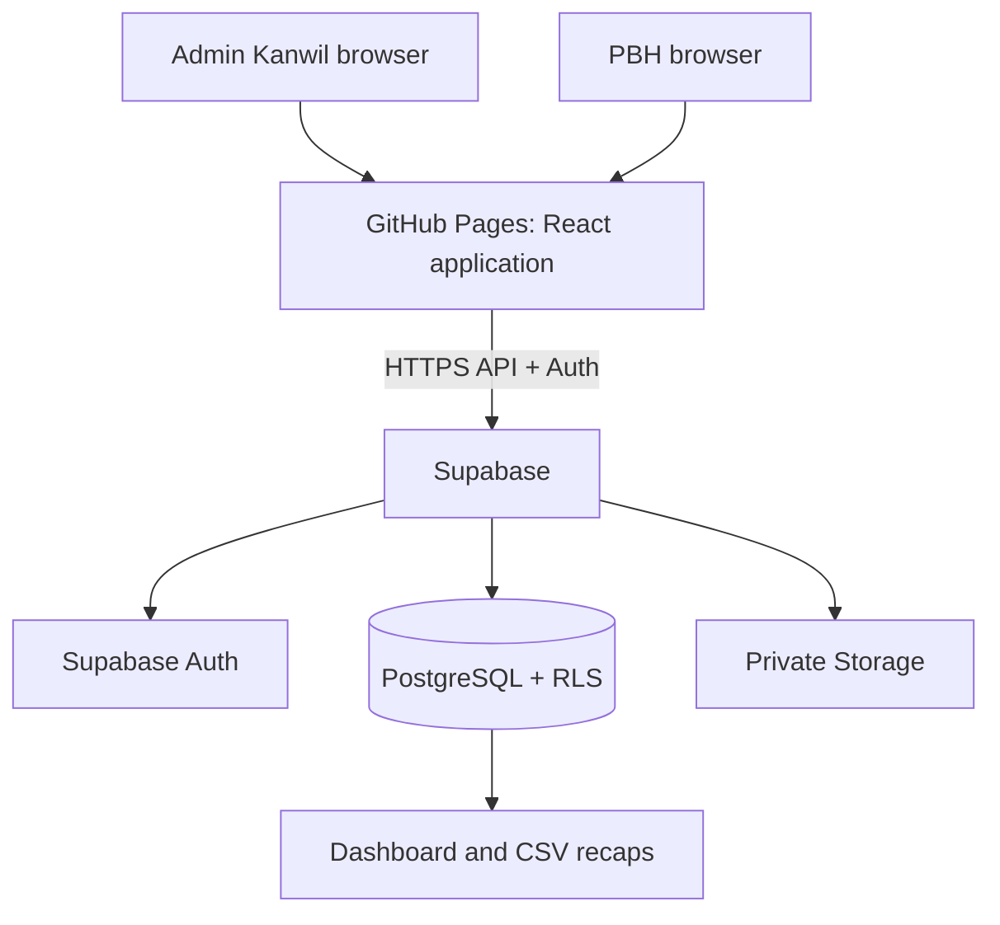
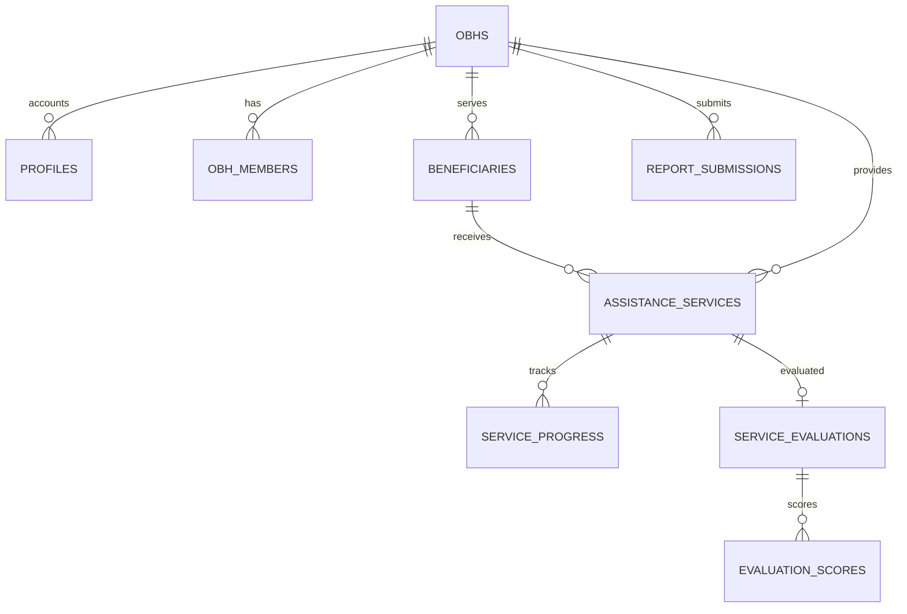
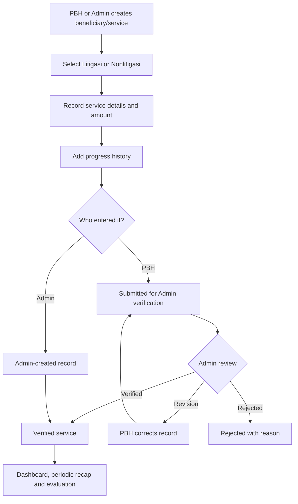

# SIP-BH V2 — Architecture and workflow

## Deployment architecture

GitHub Pages hosts static frontend files only. Supabase provides authentication, database APIs and private file storage. No Node.js server process or direct PostgreSQL pooler connection is required for browser users.

## Data relationship

## Service entry and review flow

## Roles

| Capability | Admin Kanwil | PBH |
|---|---|---|
| View PBH directory | All | Active directory and own organization |
| Manage accreditation | Yes | No |
| Manage own contact/personnel | Yes | Yes, own organization |
| Register beneficiary | Any PBH | Own PBH |
| Create service record | Any PBH | Own PBH |
| Add progress | All records | Own records |
| Verify service/report | Yes | No |
| Evaluate service | Yes | Read own results |
| Upload periodic report | Yes | Own PBH |

## Security boundaries

- Supabase Auth identifies the current user.
- `profiles.role`, `profiles.account_status` and `profiles.obh_id` determine the user's scope.
- Row Level Security (RLS) is enabled on the application tables.
- The browser only receives the public publishable/anon key; privileged secret keys are never used client-side.
- The Storage bucket for reports is private and accessed through signed URLs.
- Sensitive beneficiary fields require additional institutional privacy controls before real-world use.
